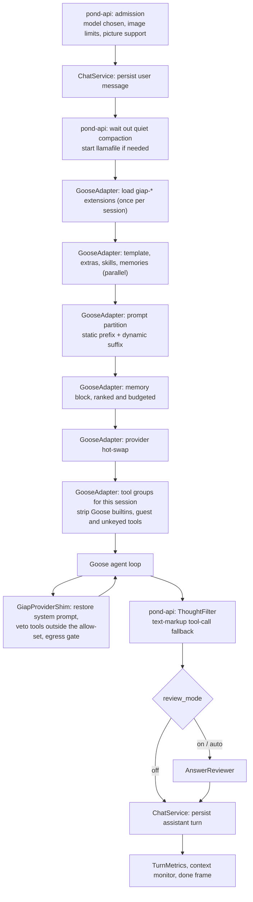

# Agent pipeline

What runs around the model on one chat turn. The main model decides on its own whether to call a
tool and which one: nothing classifies the message before it reaches the model. The stages below
prepare what the model sees, police what it may do, and clean up what it says.

Which component calls which, and what is persisted, is in [data_flow.md](./data_flow.md).

## Stages

## Before the model (`pond-api`)

| Stage | Code | Behaviour |
|---|---|---|
| No model chosen | `refuse_without_a_model` | 409 with code `NoConversationModel::CODE`; nothing is picked or downloaded instead |
| Pictures | `image_limit_response`, `prepare_turn_images` | Size and type limits (400/413/415), a 409 when the chat model cannot see pictures, then a WebP re-encode |
| User message | `ChatService::persist_user_message_with_images` | Written before inference |
| Quiet compaction | `RunSupervisor::quiet_passes().turn_arrives` (`runs.rs`, `quiet_pass.rs`) | A background compaction on this session is waited for; a `status` frame says so when it is writing this turn's summary |
| Engine readiness | `llamafile_manager`, `state.warmup` | Starts llamafile on demand (90 s limit); a warming engine yields a `status` frame |

## Inside `GooseAdapter::chat_stream`

`crates/pond-adapters-goose/src/goose_agent.rs`, in the order the code numbers its sections.

| Stage | Behaviour |
|---|---|
| Guards | `require_conversation_model`; a second picture-support backstop |
| Tool context | `pond_mcp_server::set_last_user_message` and `set_current_session_id`, read by MCP handlers |
| Engine knobs | `apply_goose_env_knobs` every turn, so toggles apply at once and the window is known before hydration |
| Session | `resolve_goose_session` maps the GIAP session to Goose's own session id |
| 0. Extensions | The registered `giap-*` builtins (`register_giap_extensions`, gated by `ext_*_enabled`) are added once per Goose session |
| 1-4. Prompt inputs | Prompt template (`prompt_style`), active prompt extras, active skills, and memory candidates (recent and topical, when `agent_memory_inject` is on and the turn's scope allows personal data) are fetched in parallel |
| Prompt partition | With `prefix_cache_prompt` (default on): a static prefix that changes only when its hash does, so the engine reuses its KV cache, and a dynamic suffix (date, time, profile). The shim is given the prefix to restore |
| Memory block | Candidates ranked by `rank_by_relevance`, cut to `CompactionProfile::max_memory_fragments` and `memory_token_budget`, minus lines an earlier turn already showed; access is recorded for decay |
| 5. Provider | `ensure_provider_current` builds or swaps the provider when the chat model changed; with none configured the turn fails with a household-readable message |
| 6. Builtins | Goose's own builtins in `GOOSE_STRIPPED_BUILTINS` (`developer`, `computercontroller`, `extensionmanager`, `todo`, `apps`, `analyze`, `summon`, `summarize`, `orchestrator`, `tom`) are removed once per session |
| 6c. Tool groups | When `tool_selection_mode` is `relevant` or `minimal` (default `all`), the tool groups for the session are chosen once and stored (`session_tool_groups`); only those schemas ride the prompt, and the shim enforces the set per call |
| 6d, 6e. Subtractions | A guest turn loses the tools `subtract_guest_denied_tools` denies, in every mode; tools whose secret (API key) is not stored are withheld |
| 7. Mode | `GooseMode::Auto` |
| 8. User text | `<user-message>` first, then `<system-context>` holding the dynamic suffix, the `<memories>` block and the answer contract (`answer_contract()`), so the system and tools prefix stays byte-stable across turns |
| History rewrite | `rewrite_history_at_turn_start` bounds how many earlier pictures are replayed and reduces any transient tool result left in goose's store to its stub; the turn's `TurnSweep` does the same when the turn ends, however it ends ([small-model-tools.md §8.10](./small-model-tools.md)) |
| Delegation | The turn's delegation authority and device claim (`GooseOrchestrator`, [pai/06-multi-agent-orchestration.md](./pai/06-multi-agent-orchestration.md)) |
| Loop guards | A repetition guard on identical tool calls; empty-turn recovery (Goose returns an empty turn, GIAP re-engages with a changed prompt); Goose's completeness check armed with the raw request when `goal_check_enabled` (default on) |

Context compaction of the conversation itself belongs to Goose; see
[token_tracking.md](./token_tracking.md).

## In the provider (`GiapProviderShim`)

`crates/pond-adapters-goose/src/provider_shim.rs` wraps every provider Goose sees. At
`Provider::stream`, where the final `(system, messages, tools)` is visible, it restores GIAP's
system prompt if Goose changed it, vetoes tools outside the turn's allow-set, and gates the
provider's endpoint through the egress policy.

## After the model (`pond-api`)

| Stage | Code | Behaviour |
|---|---|---|
| Thought filter | `crates/pond-api/src/thought_filter.rs` | Strips Harmony thought channels and `<think>` blocks from visible text; captures them as `thinking` frames when `show_thinking` is on and the turn is not a voice turn |
| Text tool calls | `ThoughtFilter::take_tool_calls`, `parse_tool_envelope` | A tool call the model wrote as Harmony text markup is executed through `Agent::call_tool` and reported as `tool_call` / `tool_result` frames |
| Answer review | `AnswerReviewer` port (`crates/pond-core/src/models/ports/answer_reviewer.rs`), `GiapAnswerReviewer` in `crates/pond-server/src/main.rs` | `review_mode`: `off` (default), `on` (every turn), `auto` (messages containing `?` or opening with what, how, why, explain, compare, analyze). Critiques with `REVIEW_SYSTEM_PROMPT` on the side-call provider for up to `review_max_rounds` (default 1); below `review_pass_threshold` (default 3 of 5) the answer is revised |
| Persistence | `ChatService::persist_assistant_turn` | Tool rows, the assistant row, usage, title |

## The optional parameter specialist (`ToolCaller`)

When `settings.tool_model` names a model (default unset) and the build has `local-inference`,
`pond-server` loads `ToolCallerEngine` (`crates/pond-adapters-local-inference/src/tool_caller.rs`)
and installs it with `pond_mcp_server::set_tool_caller`. It does not decide whether a tool is
called: inside a few MCP handlers (`knowledge.rs` `resolve_topic`, `schedule.rs`) it regenerates the
parameters the main model passed. With no tool model, handlers use the main model's parameters.

## SSE frames

| `type` | Emitted by | Content |
|---|---|---|
| `run_started` | `chat_stream` (resumable only) | `run_id`, `session_id`, `epoch` |
| `status` | pond-api, GooseAdapter | Progress text |
| `thinking` | Thought filter | Reasoning text, when `show_thinking` |
| `text` | Model | Visible tokens |
| `tool_call`, `tool_result` | Goose loop or text-markup fallback | Tool name, id, input or content (`ui` hint for MCP-UI) |
| `subagent_progress` | Delegation | Child state; tool name or failure reason only |
| `turn_limit_reached` | GooseAdapter | The turn budget ran out before the task finished |
| `turn_stats` | GooseAdapter | TTFT, prefill, decode speed, token counts, context use |
| `review_status`, `review_revision` | Answer review | Progress, or the revised answer that replaces the streamed text |
| `context_warning` | Context monitor | Utilisation and turns remaining |
| `cancelled` | Run cancel | `run_id`, `at_seq` |
| `reattached`, `replay_gap`, `run_evicted` | Detached runs | Reattach bookkeeping |
| (no type) `done: true` | End of turn | `session_id`, `model_name`, `usage`, `interrupted` |
| (no type) `error` | Any stage | Error message; ends the stream |
